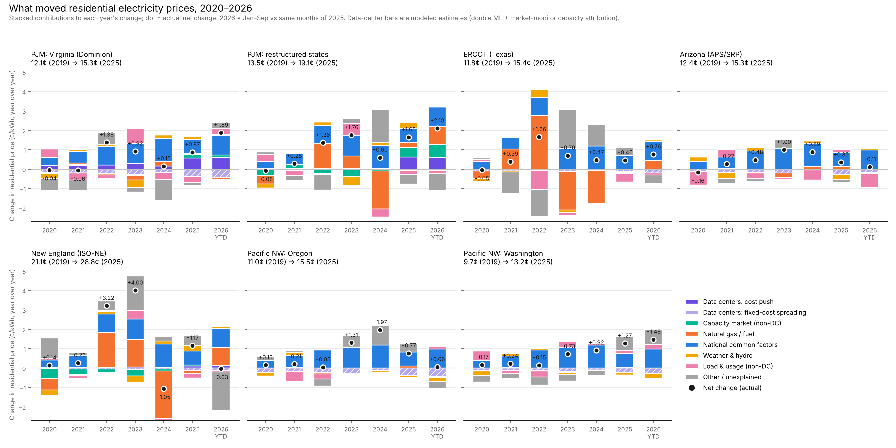

# Data centers and residential electricity prices

NOTE: This analysis is solely mine for personal exploration and enjoyment, does NOT represent peer-reviewed research, and does NOT reflect the views or opinions of my employer.

Q: How much of the 2020–2026 change in residential electricity prices came from data centers, and how much from everything else? 

This project looks at five US markets:
- PJM, split into Virginia (Dominion) and the restructured PJM states (DE, DC, MD, NJ, OH, PA)
- ERCOT (Texas)
- Arizona (APS/SRP)
- New England (ISO-NE)
- Pacific Northwest, split into Oregon and Washington

The best summary of the results and analysis can be found on [Streamlit](https://datacenter-electricity-price-exploration.streamlit.app/).



Each bar stacks the estimated contributions to that year's change in the average residential price (¢/kWh). The dot is the actual change. The purple diamond and line beside each bar show the net data center effect and its 95% range. The chart shows 2022–2026 (set by `START_YEAR` in `src/chart.py`); `output/decomposition.csv` has every year from 2020. 2026 is January–September 2026 compared with the same months of 2025.

## Headline findings (cumulative 2022–2025, ¢/kWh)

| Market | Actual change | Data centers, net | 95% range | of which: capacity market | of which: local load |
|---|---|---|---|---|---|
| PJM: restructured states | +5.36 | **+0.57** | +0.27 to +0.88 | +0.54 | +0.04 |
| PJM: Virginia (Dominion) | +3.32 | **+0.69** | −1.76 to +3.15 | +0.18 | +0.52 |
| New England | +7.33 | +0.05 | −0.26 to +0.36 | 0 | +0.05 |
| ERCOT (Texas) | +3.29 | −0.19 | −0.51 to +0.13 | 0 | −0.19 |
| Arizona | +2.72 | −0.87 | −2.34 to +0.61 | 0 | −0.87 |
| Oregon | +4.09 | −1.14 | −3.15 to +0.87 | 0 | −1.14 |
| Washington | +3.06 | −0.31 | −0.86 to +0.23 | 0 | −0.31 |

- **The one effect the data pins down is PJM's capacity market.** PJM's market monitor attributes 45% of capacity charges from the 2025/26 auction on (40% for 2028/29) to data center load, and those costs are spread across every PJM state. In the restructured PJM states this adds about +0.5¢/kWh in 2025 and +0.6¢ in 2026 YTD, with a tight range. It holds up under every specification.
- **More is already coming.** The 2026/27–2028/29 auctions have cleared at or near the price cap. In restructured-state residential rates, the data center share of capacity costs roughly doubles, from 0.54¢/kWh in 2025 to about 1.0–1.1¢ in 2026–2028 (`output/capacity_outlook.csv`).
- **Local data center effects can't be pinned down.** For Virginia the 95% range runs from −1.8¢ to +3.2¢, which covers anything from "data centers lowered prices" to "they caused all of the increase." The small bars elsewhere are the middle of wide ranges, not evidence of a small effect.
- **The earlier evidence that data centers lower prices outside capacity markets was partly an artifact.** With a state-specific data center load measure, the negative effect shrinks (double ML: −0.11¢ per percentage point of load share, SE 0.09). It is no longer statistically significant in any market.
- **Most of the increase everywhere is not data centers, as far as the model can tell.** National common factors account for about +3.8¢ of the 2022–2025 increase in every market. About **2.7¢ is general inflation** passing through to rates. The other **1.1¢ is above inflation**, consistent with the nationwide grid spending wave, higher interest rates feeding into rate cases, and equipment costs. A test of whether national data center growth drives that remainder found no evidence either way (see below). Natural gas drove the 2022–23 spikes in restructured markets and the 2024 reversal (New England, PJM, ERCOT).

## Method

1. **Panel data.** 49 states (contiguous US plus DC) by year, 2010–2025, plus January–September 2026, built from public data. Sources: EIA-861M residential revenue, sales and customers; EIA-923 generation mix; EIA gas prices to power plants and Henry Hub; FRED CPI, 10-year Treasury yield and transformer PPI; NOAA heating and cooling degree days.
2. **Capacity costs (mechanical).** PJM and ISO-NE auction prices are converted to ¢/kWh of residential load. Restructured states get full pass-through; Virginia and West Virginia get 20%, since their utilities self-supply most capacity. The data center share comes from the PJM market monitor and is mapped by auction delivery year (June–May): 45% for 2025/26–2027/28, 40% for 2028/29, each ±5 points for the uncertainty range. These costs are subtracted from the price before estimation.
3. **Data center load, two measures.**
   - **National scaling (original):** each state's 2023 data center load comes from EPRI (2024) state shares; the remaining national load is allocated by commercial sales. It is scaled over time by the LBNL national series: 58 TWh (2014), 176 TWh (2023), 192 TWh (2024), with 2025–26 extrapolated at about 20% a year. Every state grows at the national rate.
   - **State-specific (headline):** for states with an EPRI estimate, load from 2020 on follows the state's own commercial + industrial load above its 2012–2019 trend, chained from the 2019 level. It is used only where its implied 2023 level is within 35% of EPRI's. That covers Virginia, Oregon, Arizona, North Dakota, Utah and Wyoming. In Texas, Washington, Iowa, Nevada and Nebraska, other industrial or crypto-mining load swamps the signal, so national scaling is kept.
4. **Double machine learning** (`src/model.py`). A partially linear model with state and year fixed effects, using LightGBM models for the controls and cross-fitting grouped by state (5 folds × 5 repeats, standard errors clustered by state). The treatment is data center share of state load and its one-year lag, each interacted with a capacity-market indicator. The full covariance matrix gives the 95% ranges.
5. **Other factors.** A two-way fixed-effects regression of the price (net of capacity and data center effects) on:
   - gas cost: in-state gas share × gas price, plus marginal gas price in restructured retail states, current and lagged
   - hydro share
   - degree days
   - use per customer
   - non-data-center load
6. **Decomposition.** Each factor's contribution is its coefficient × the year-over-year change in that factor. The change in the year fixed effect is the national common factor, split into two bars:
   - **Inflation:** the prior year's national average residential price × CPI inflation, averaged over this year and last because rate cases lag. Pass-through is set to 1, not estimated. Over 2012–2019 this explains the national common trend almost exactly.
   - **Grid costs & rates above inflation:** the remainder.

   Inflation, interest rates and transformer prices can't be estimated separately, because they are national series and CPI and the transformer price index move almost together (correlation 0.96, 14 years). Free regressions on them gave unstable, wrong-signed coefficients.

   Whatever is left after the national bars is "other / unexplained," which covers state-specific transmission and distribution rate cases, policy charges, storm and wildfire recovery, and fuel-clause timing.
7. **Splitting the data center effect into two bars.** Fixed-cost spreading is calculated mechanically: 50% of the prior rate × the data center load growth ÷ total load. The cost push is the net effect minus the spreading. If the estimated net effect is more negative than the mechanical spreading, all of it is shown as spreading. The 95% range on the net effect combines the sampling uncertainty of the local estimate with the ±5-point band on the capacity attribution.
8. **National data center channel.** The above-inflation national bar (2012–2025) is regressed on the yearly change in data centers' share of US load.

## Robustness: do the methods agree?

**Local effect of a sustained +1 pp data center share, states outside capacity markets (¢/kWh):**

| Method | Estimate |
|---|---|
| Double ML, state-specific load + lag (headline) | −0.11 (SE 0.09) |
| Two-way fixed-effects OLS, same specification | −0.24 (SE 0.11) |
| Double ML, original national-scaling load measure | −0.20 (SE 0.10) |
| Gradient boosting + SHAP slope | −0.07 |
| Synthetic control: Arizona | −0.04 (placebo p = 0.18) |
| Synthetic control: Virginia | +0.02 (p = 0.59) |
| Synthetic control: Oregon | **+0.16 (p = 0.05)** |

**Cumulative 2022–2025 data center effect under each specification (¢/kWh, 95% range):**

| Market | State-specific + lag (headline) | State-specific, no lag | National scaling + lag | National scaling, no lag (original) |
|---|---|---|---|---|
| PJM: Virginia | +0.69 [−1.76, +3.15] | +0.48 [−1.33, +2.28] | +0.18 [−1.43, +1.78] | +0.23 [−1.42, +1.89] |
| PJM: restructured | +0.57 [+0.27, +0.88] | +0.58 [+0.28, +0.88] | +0.56 [+0.26, +0.86] | +0.55 [+0.25, +0.84] |
| ERCOT (Texas) | −0.19 [−0.51, +0.13] | −0.17 [−0.47, +0.13] | −0.47 [−0.86, −0.09] | −0.36 [−0.72, −0.00] |
| Arizona | −0.87 [−2.34, +0.61] | −0.80 [−2.20, +0.59] | −0.75 [−1.43, −0.07] | −0.67 [−1.35, −0.00] |
| New England | +0.05 [−0.26, +0.36] | +0.05 [−0.26, +0.36] | +0.02 [−0.28, +0.32] | +0.01 [−0.29, +0.31] |
| Oregon | −1.14 [−3.15, +0.87] | −0.93 [−2.55, +0.69] | −0.95 [−1.98, +0.08] | −1.04 [−2.08, −0.00] |
| Washington | −0.31 [−0.86, +0.23] | −0.30 [−0.83, +0.23] | −0.59 [−1.23, +0.04] | −0.64 [−1.28, −0.00] |

The PJM capacity effect is stable everywhere. The local effects are not: the original measure made them look negative and borderline significant, while the state-specific measure makes them smaller and clearly uncertain. The synthetic control for Oregon points the other way: Oregon prices rose about 2¢ more than its synthetic comparison in 2024–25. That jump coincides with large Portland General Electric and PacifiCorp rate increases (power costs, wildfire mitigation), which this method cannot separate from data center growth.

**National channel:** regressing the above-inflation bar on the change in data centers' share of US load gives +0.07¢ per percentage point (SE 0.13, p = 0.56). That would explain about 0.17¢ of the 1.05¢ above-inflation increase over 2022–2025. With 14 yearly data points this test finds no evidence of a national data center effect, but it could not rule out a moderate one either.

Details are in `output/model_results.json` (all specifications, covariance matrices, load-measure validation) and `output/robustness.json`.

## Key assumptions and limitations

- **No observed state-by-year data center load series exists.** The state-specific measure attributes all of a state's commercial + industrial growth above trend to data centers. It is used only where it matches EPRI's 2023 level, and it remains noisy. Utility-reported data center sales would be better, but they aren't in a public dataset.
- **The model probably still understates data center effects in some ways:**
  - Retail rates lag costs by 1–3 years through rate cases, and much of the transmission and generation built for data centers enters rates after 2025.
  - Any nationwide effect (equipment prices, supply chains) sits in the national bars.
  - Dominion's 2025 rate review (Virginia's +1.9¢ in 2026 YTD) lands in "other."
  - The 20% capacity pass-through for Virginia is a judgment call.
- **Inputs with low or medium confidence** are flagged in `data/inputs/*.csv`. Pre-2020 capacity prices and some EPRI state shares come from secondary sources and should be checked against the primary reports. 2025–26 national data center load is an extrapolation.
- **Geography is state-level.** Arizona combines APS, SRP and TEP. Virginia includes Appalachian Power as well as Dominion. Texas includes some non-ERCOT load. Utility-level splits would need the EIA-861 utility files.
- **Things not modeled explicitly:**
  - the Winter Storm Uri securitization charges in Texas
  - Texas fixed-price retail contracts, which delay gas pass-through by more than a year (hence the large "other" bars in Texas in 2023–24)
  - Massachusetts and Connecticut policy charges
  - Washington's Climate Commitment Act
  - Oregon and Arizona wildfire costs
- **The two national bars assume every state got the average common shock.** Deviations from that average land in "other / unexplained." The "above inflation" bar is a remainder, not a direct measurement of grid spending or interest rates.

## Dashboard

```bash
pip install -r requirements.txt
```

```bash
streamlit run app.py
```

Two pages:

- **Results:** the published baseline, read from `output/`.
  - **Price decomposition:** the stacked chart for all markets or one, grouped or detailed factors, with a table and CSV download.
  - **Data center effect:** cumulative effect by market with 95% ranges, the method comparison, the capacity costs already set by PJM auctions, the specification comparison and the load-measure validation.
  - **National factors:** inflation vs above-inflation, 2012–2026.
  - **Price history:** residential price by market, 2010–2026 YTD.
  - **Method & caveats:** the method and limitations sections of this README.
- **Assumptions & sensitivity:** change the modeling assumptions and compare every result with the baseline.
  - **Mechanical assumptions update in about a second:** the data center share of PJM capacity costs and its band, fixed-cost spreading, inflation pass-through, and how ranges combine.
  - **Assumptions that change the econometric estimates use precomputed alternatives when available** (19 one-at-a-time variants in `output/scenarios/`). Any other combination has a **Re-estimate** button that reruns the headline specification, about 15–40 seconds. Results are kept on the server for anyone who picks the same assumptions.
  - **Every scenario can be downloaded as JSON** and rerun from the command line.

The full assumption inventory, with where each one is implemented, what depends on it and its limitations, is in [docs/ASSUMPTIONS.md](docs/ASSUMPTIONS.md).

## Code layout

| File | Role |
|---|---|
| `src/config.py` | Every modeling assumption, with its baseline value, source, UI range and whether it changes the estimates. `ModelConfig.baseline()` reproduces the published results. |
| `src/pipeline.py` | The model as three stages driven by a config: `prepare` (capacity costs, data center load, features), `estimate` (double ML + fixed effects; cached by `cfg.estimation_key()`), `attribute` (mechanical splits, national bars, ranges, outlook). |
| `src/build_panel.py` | Raw EIA/FRED/NOAA files → `data/processed/panel_monthly.parquet` (raw-data steps only). |
| `src/model.py` | Runs the headline and three alternative specifications and writes `output/`. |
| `src/robustness.py`, `src/chart.py` | SHAP and synthetic control checks; static chart and chart data. |
| `src/scenarios.py` | Precomputes estimates for common alternatives (`output/scenarios/`). |
| `src/display.py`, `src/ui.py`, `views/`, `app.py` | Dashboard. |
| `tests/test_baseline.py` | Golden-file tests: the pipeline must reproduce the published outputs (`tests/golden/`) within 1e-9, plus invariants of the mechanical assumptions. |

## Reproduce

Requires Python 3.11+. Versions are pinned so the baseline reproduces exactly.

```bash
pip install -r requirements.txt
```

```bash
src/download.sh
```

```bash
cd src && python3 build_panel.py && python3 model.py && python3 robustness.py && python3 chart.py && python3 scenarios.py
```

Run a scenario saved from the dashboard (writes the same files to a separate folder):

```bash
python3 src/model.py --config scenario.json --out output_scenario
```

Check that the baseline still reproduces:

```bash
pip install -r requirements-dev.txt && python3 -m pytest tests -q
```

Outputs:

- `output/decomposition.csv`: every component, by market and year, with 95% ranges on the data center effect
- `output/capacity_outlook.csv`: PJM capacity costs in residential rates through 2028, total and data center share
- `output/model_results.json`: coefficients, covariance matrices, all four specifications, load-measure validation, national-channel test, the full configuration and its estimation key
- `output/robustness.json`: SHAP and synthetic control results
- `output/scenarios/`: precomputed estimates for the dashboard's alternative assumptions
- `output/decomposition_chart.png`: the chart
